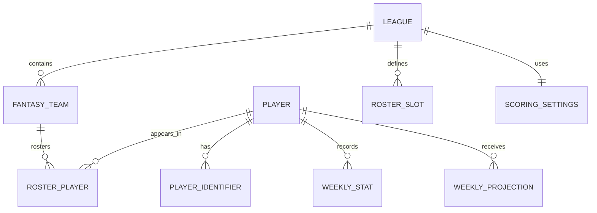

# Data Model

## Status

The core in-memory domain model is implemented in `src/domain`. Exact database types, indexes, and ORM syntax will be finalized during the database stage.

## Implemented domain boundaries

- Player positions are `QB`, `RB`, `WR`, `TE`, `K`, and `DST`.
- `FLEX` and `SUPERFLEX` are lineup slots, not player positions.
- FLEX eligibility is derived centrally as RB/WR/TE.
- SUPERFLEX eligibility is derived centrally as QB/RB/WR/TE.
- Weekly availability belongs to projections rather than permanent player identity.
- Normalized weekly counting statistics default to zero when the source does not provide them.
- `pointsAllowed` is nullable so `null` can distinguish a non-defense stat line from a defense that allowed zero points.
- A league snapshot contains normalized league rules, players, teams, rosters, projections, and optional raw statistics without depending on a database or external API.
- Runtime validation checks both structure and cross-record relationships before engines consume a snapshot or trade proposal.
- League-specific fantasy points are calculated rather than stored in the in-memory model.

Type-level support for kicker and SUPERFLEX does not resolve whether either is required for the first public release; those product decisions remain pending.

## Design principles

- Use internal IDs throughout domain logic.
- Store external identifiers separately.
- Store raw football statistics separately from calculated fantasy points.
- Version projections and analytical outputs.
- Preserve league-specific scoring and roster rules.
- Treat imported rosters as snapshots that can be refreshed.

## Entity relationships

## Core entities

### Player

- `id`: internal stable ID
- `full_name`
- `position`
- `nfl_team`
- `active_status`
- optional biographical disambiguators

### PlayerIdentifier

- `player_id`
- `source`
- `external_id`
- `verified_at`
- optional match method and confidence for reviewed imports

Constraint: `(source, external_id)` is unique.

### WeeklyStat

- `player_id`
- `season`
- `week`
- `season_type`
- raw passing fields
- raw rushing fields
- raw receiving fields
- fumbles and other supported scoring inputs
- opportunity fields such as attempts and targets
- source version and retrieval metadata

Constraint: one authoritative row per player, season, week, season type, and source/modeling grain.

### WeeklyProjection

- `player_id`
- `season`
- `week`
- `expected_points`
- `low_points`
- `high_points`
- `model_version`
- `generated_at`

Constraint: `(player_id, season, week, model_version)` is unique.

### League

- `id`
- `platform`
- `external_id`
- `name`
- `season`
- `team_count`
- import and refresh timestamps

Constraint: `(platform, external_id, season)` is unique.

### ScoringSettings

- `league_id`
- normalized supported scoring multipliers
- source configuration as validated JSON for traceability

An omitted supported multiplier contributes zero points. The scoring engine multiplies each normalized statistic by the corresponding league multiplier and applies exactly one points-allowed tier when that statistic is applicable.

### RosterSlot

- `league_id`
- `slot_type`
- `quantity`
- eligible positions

### FantasyTeam

- `id`
- `league_id`
- `external_id`
- `owner_external_id` when available
- `owner_display_name`
- `team_name`

Constraint: `(league_id, external_id)` is unique.

### RosterPlayer

- `fantasy_team_id`
- `player_id`
- `roster_status` such as starter, bench, injured reserve, or taxi
- source snapshot timestamp

Constraint: a player cannot appear on two teams in the same imported league snapshot.

### ImportRun

- `id`
- `source`
- `started_at` and `completed_at`
- `status`
- source version
- inserted, updated, rejected, and unmatched counts
- error summary

## Domain objects not necessarily persisted

### TradeProposal

- `team_a_id`
- `team_b_id`
- `team_a_sends`
- `team_b_sends`

### TradeSimulationResult

- validated and normalized proposal
- copied post-trade roster for team A
- copied post-trade roster for team B

Simulation removes outgoing players while preserving the relative order of every retained player, then appends incoming players in proposal order. It does not modify the source league snapshot and does not enforce a roster-size cap that is not present in the league domain model.

### OptimizedLineup

- assignments from roster slots to players
- total projected points
- bench players
- unfilled slots

The optimizer treats each requested slot quantity as a distinct slot instance. A player can be assigned at most once. Its objective is lexicographic: maximize the number of filled valid slots, then maximize total expected points. Players without a supplied projection remain eligible with zero projected points.

### TradeAnalysis

- original and simulated lineup totals
- weekly and rest-of-season changes
- starters entering and leaving
- depth and scarcity changes
- risk components
- raw fairness components
- verdict code
- algorithm versions

Persist trade analyses only if saved/shareable results become a confirmed feature.

## Invariants

- A player cannot fill more than one slot in a lineup.
- A simulated trade never mutates the imported roster snapshot.
- Every rostered source player must map to one internal player or appear in an unresolved report.
- Low projection must be less than or equal to expected, which must be less than or equal to high.
- Rest-of-season impact equals the sum of displayed weekly impacts.
- Every verdict must be reproducible from stored or returned components and algorithm versions.

## Open implementation decisions

- Prisma versus Drizzle
- UUID versus generated numeric internal IDs
- Whether league snapshots need explicit version tables
- JSON versus normalized columns for uncommon scoring rules
- Whether calculated league-specific fantasy points should be cached or always computed
